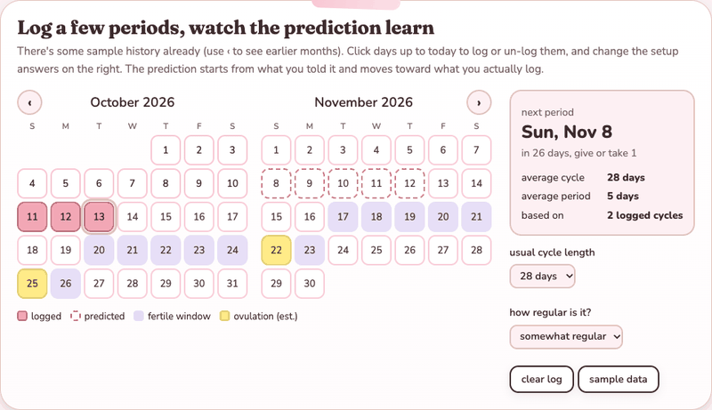

# Period Tracker

A small offline period tracker for macOS. Log your period on a calendar, note symptoms, flow and mood, and get predictions that sharpen as you log. Nothing ever leaves your Mac.

## Demo



Recorded from the app itself running on made-up sample data (none of it is real health data). There's also a browser version on my portfolio: [try it here](https://nicole-li7.github.io/projects/cycle.html).

## Features

**Calendar**
- **Month view**: click a day to open it; click a greyed-out day from a neighbouring month to jump there.
- **Navigation**: Left/Right arrows or the `<` `>` buttons change month; `T` or the Today button jumps back to today.
- **Quick log**: Space logs (or unlogs) today's period without opening anything.
- **Colour key**: solid rose is a logged period, rose outline is predicted, blue fill is the fertile window, deeper blue outline is the peak day, and a ring marks today. A dot under a day number means it has notes.

**Day panel**
- **Period**: mark a day as a period day (Space also toggles it here).
- **Flow**: light, medium or heavy, shown only on period days.
- **Symptoms**: cramps, headache, bloating, fatigue, nausea, backache, sore breasts, acne; any number at once.
- **Mood**: good, calm, irritable, anxious or low; one per day.
- **Clear day** wipes the date; Done, Enter or Escape closes the panel.

**Predictions (sidebar)**
- **Next period**: a countdown plus the date and a margin of error, or "Period day N" while one is under way.
- **Cycle day**, **average cycle**, **average period** and the date the last period began.
- **Fertile window and peak day**: estimated and shown on the calendar, including months ahead.
- **Basis line**: says how many logged cycles the figures rest on.
- **Setup answers count at first**: they act as a starting guess that real data gradually replaces.

**Setup**
- **First-run questions**: cycle length, period length, regularity, age and when your last period started. All optional ("Not sure" skips one, "Skip" skips all).
- **Last period start** is logged on the calendar for you; click to correct it.
- **Setup button** in the sidebar reopens the questions any time.

**Symptom summary**
- **Summary button**: each symptom gets a one-cycle track (period and fertile window shaded) with a mark at each cycle day it was recorded.
- **Counts and typical day**: days recorded and the median cycle day, or "not enough yet" under three placed occurrences.
- **Mood and flow totals**, shown alongside.
- **Read-only**: it never changes the predicted dates.

**Other**
- **Escape** closes the open panel or screen; on the plain calendar it quits.

## Getting started

Install the dependencies, then build and install:

```sh
brew install cmake sdl2 sdl2_ttf
cmake -S . -B build -DCMAKE_BUILD_TYPE=Release
cmake --build build
cmake --install build          # puts Period Tracker.app in /Applications
```

After that it opens from Spotlight, Finder or the Dock. To run from the build folder with output in the terminal:

```sh
'./build/Period Tracker.app/Contents/MacOS/Period Tracker'
```

## How it's built

C++20 with SDL2 and SDL2_ttf, built with CMake. Dates use `<chrono>`. After each build, `tools/bundle_libs.sh` copies the Homebrew libraries into the app and ad-hoc signs it, so the installed app does not need Homebrew. The icon comes from `tools/make_icon.py`, and the colour theme lives in the `color` namespace in `src/ui.h`.

```
src/main.cpp       window, main loop, screen switching
src/tracker.*      logging, cycle analysis, predictions, saving
src/profile.*      setup answers and how much they are trusted
src/symptoms.*     per-day symptoms, flow and mood
src/dayeditor.*    the day panel
src/insights.*     the symptom summary
src/onboarding.*   the setup screens
src/date.*         date helpers
src/ui.*           palette, fonts, widgets, calendar drawing
tools/             bundle_libs.sh, make_icon.py
assets/            AppIcon.icns
```

New source files go in the `add_executable` list in `CMakeLists.txt`.

## Your data

Everything stays on this Mac in `~/Library/Application Support/PeriodTracker/`. There is no networking, no account and no telemetry.

- `log.csv`: one ISO date per line, the days you logged as a period.
- `symptoms.csv`: `date,flow,symptoms,mood`, one row per day with notes.
- `profile.txt`: your setup answers as `key=value` lines.

They are plain text, so you can back them up or edit them by hand; changes are picked up next launch. The predictions are averages of your own history, not medical advice, so don't rely on the fertile window for contraception.
